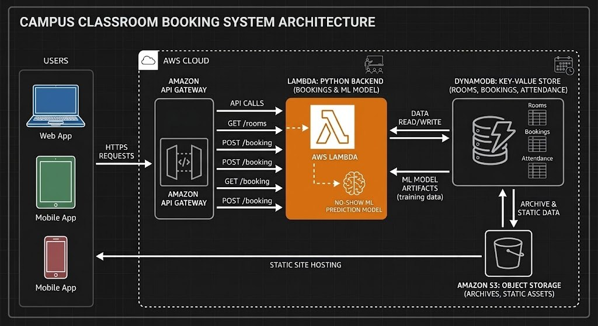

# Roomly Campus Room Booking with Historical Reservation Analytics

Roomly provides authenticated room booking, participant selection,
shared availability, cancellation, check-in and administrator room
management. Historical reservation analytics help administrators
understand demand by room, weekday and start hour.

## Team

| Member | Responsibility |
|---|---|
| Teo Xue Ling Sharlene | Frontend and user interface |
| Su Ying Stanberley | Backend booking logic and consistency |
| Shermaine Chan Jing Xuan | AWS deployment, integration and cloud evidence |
| Wei Yuchen | Historical data analysis and validation |

Group: P2-GROUP-01

## Architecture and technologies

The frontend runs locally and connects to a shared AWS backend.

Technologies: HTML, CSS, JavaScript, Python, Amazon Cognito,
API Gateway HTTP API, AWS Lambda, DynamoDB, S3 and CloudWatch.

Historical analytics use prepared S3 outputs and are separate from
live DynamoDB bookings. No no-show prediction model is included.

## Quick start

Run these commands from the project root.

Mac:

    python3 -m http.server 8766 --bind 127.0.0.1 --directory src/frontend

Windows:

    py -m http.server 8766 --bind 127.0.0.1 --directory src/frontend

Open http://127.0.0.1:8766/ and sign in using an assigned Cognito
test account. Keep the terminal open while using the website.

Requirements: Python 3, internet access, an available AWS backend,
and a Cognito account mapped to an active Roomly user.

The current website uses the AWS backend. Starting the older
SQLite application server is not required for this workflow.

## Documentation

- [Startup instructions](START_HERE.md)
- [User guide](USER_GUIDE.md)
- [Deployment configuration](src/infrastructure/README.md)
- [Deployment evidence](evidence/deployment.md)
- [Dataset documentation](data/README.md)
- [Analytics reproduction](analytics/README.md)
- [Project manifest](project_manifest.yaml)
- [Team contributions](TEAM_CONTRIBUTIONS.md)
- [AI use declaration](AI_USE_DECLARATION.md)

## Verification evidence

- [Functional tests](evidence/test-functional.md)
- [Security tests](evidence/test-security.md)
- [Backend tests](evidence/test-backend.md)
- [Interface tests](evidence/test-ui.md)
- [Sign-in tests](evidence/test-auth-ui.md)
- [Analytics validation](evidence/test-data-ai.md)
- [Cloud analytics integration](evidence/test-analytics-cloud.md)
- [Recovery test](evidence/test-resilience.md)
- [Monitoring](evidence/monitoring.md)

## Limitations

The frontend is locally served. The cloud demonstration depends
on the AWS Academy environment. Cloud conflict and concurrency
checks without recorded results remain pending.

Historical reservations do not establish attendance or occupancy.
Check-in is self-reported. S3 version retrieval does not demonstrate
whole-application recovery. High-load performance and verified
least-privilege IAM permissions are not established.

Passwords, AWS credentials and authentication tokens will not be
included in the repository or submission.
